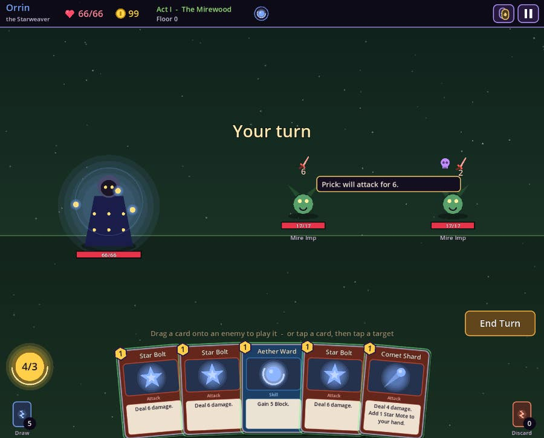
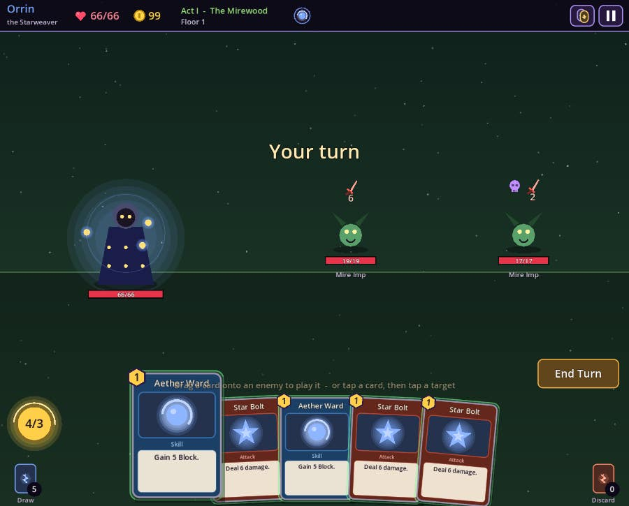
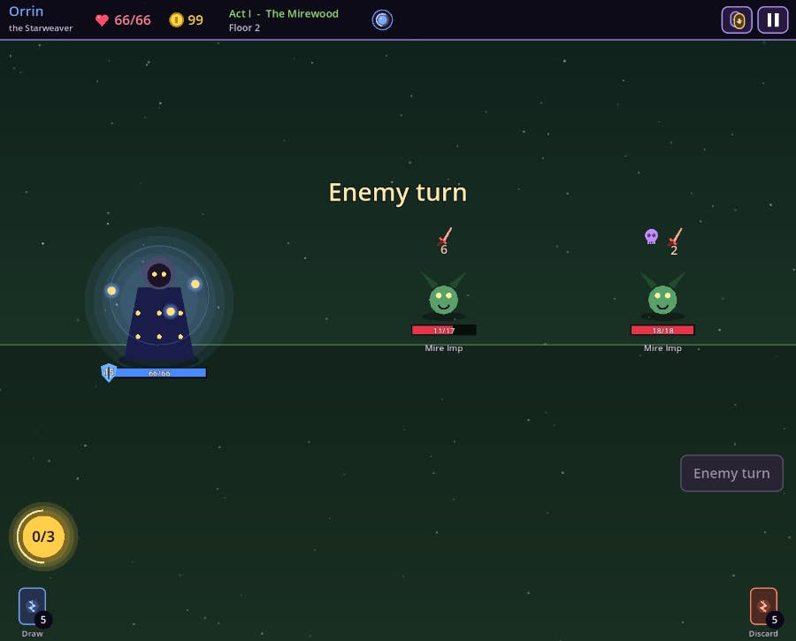
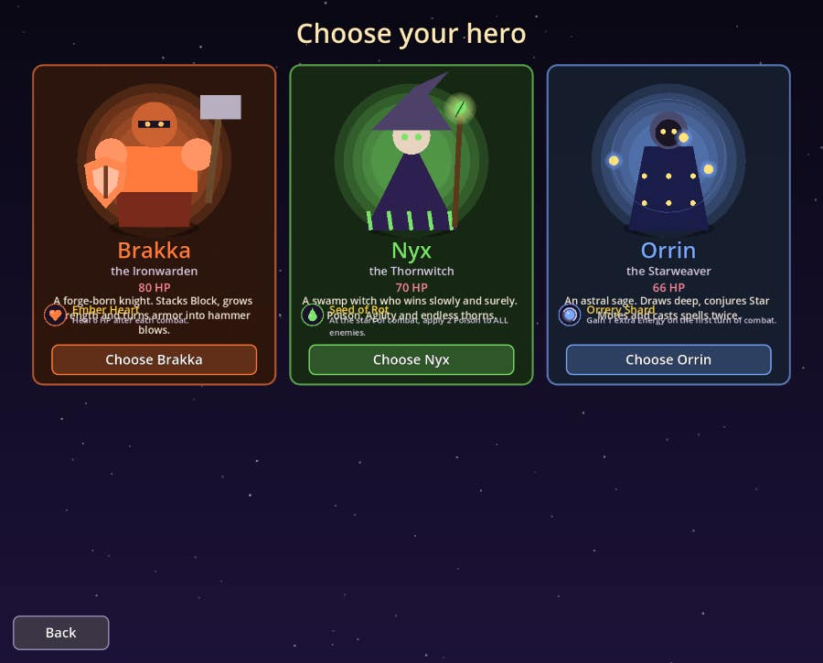
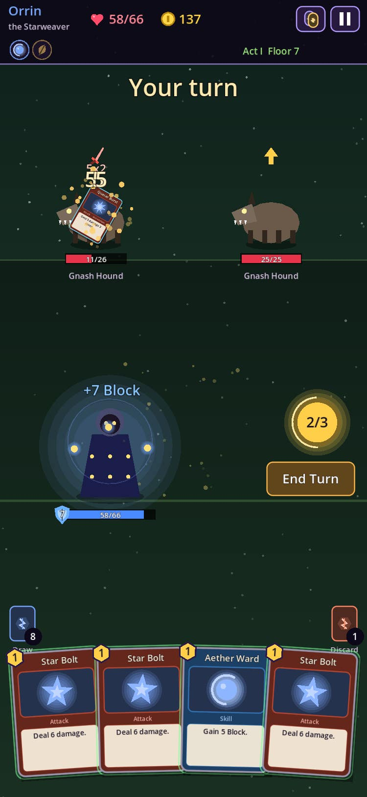

<div align="center">

# 🃏 ARCANE DECK

### A deck-building card roguelike of spells, relics and three cursed acts

[](https://jaigod.github.io/arcane-deck/play/)

[](https://jaigod.github.io/arcane-deck/)
[](https://godotengine.org)
[](https://github.com/JaiGod/arcane-deck/actions/workflows/pages.yml)
[](LICENSE)

</div>

Pick one of three heroes, climb a branching map through **three acts**, build a deck from **90 original cards**, collect **23 relics** and beat the boss at the top of each act. Every run is different. All the art is drawn in code and every sound is synthesized at startup, so there are no image or audio files.

## 📸 Screenshots

| Title | Branching map |
|:---:|:---:|
|  |  |
| **Combat with enemy intents** | **Choose your hero** |
|  |  |

<div align="center"><br><sub>Portrait phone layout with drag-to-play cards</sub></div>

## ✨ Features

- **3 heroes, 30-card pools each**
  - 🔥 **Brakka the Ironwarden** stacks Block and Strength.
  - 🌿 **Nyx the Thornwitch** wins with Poison and Agility.
  - ✨ **Orrin the Starweaver** draws deep and casts spells twice.
- **Classic deck-building combat:** 3 Energy and 5 cards a turn, Block, and 8 statuses (Strength, Agility, Vulnerable, Sapped, Poison, Regen, Spikes, Echo). It also has 9 permanent powers and exhaust cards.
- **Readable enemy intents:** every enemy shows whether it will attack (with the exact damage), defend, power up, curse you or summon help.
- **Branching maps** with combats, elites, campfires (rest or upgrade), merchants (cards, relics, card removal), 8 mystery events and treasure chests.
- **3 acts, 21 enemies, 3 bosses:** the Rootmother, the Glass Tyrant and the Unwoven.
- **Card upgrades and removal**, boss relics between acts, and an unlock track that adds new cards as you slay bosses.
- **Run history**, best score, auto-save on every map visit, and a continue button.
- **Touch first:** drag a card onto an enemy, or tap a card then tap a target. There is a portrait phone layout, and the keyboard works too.
- **Juice:** screen shake, particles, hit flashes, enemy lunges, floating numbers, card fly-outs and a pulsing End Turn button when you are out of moves.

## 🎮 Controls

| Action | Mouse / touch | Keyboard |
|---|---|---|
| Play a card | Drag it onto an enemy, or tap card → tap target | `1`–`9` select, `Tab` target, `Enter` play |
| Skills / powers | Drag above your hand, or tap twice | `Enter` |
| End turn | **End Turn** button | `E` |
| Inspect | Hover or tap enemies, statuses, relics and piles | – |
| Pause / menu | ⏸ button | `Esc` |
| Scroll the map | Drag or mouse wheel | – |

## 🛠 Tech stack

- **Godot 4.3** with GDScript and the **Compatibility (GL ES 3 / WebGL 2) renderer**
- Web export with **threads disabled**, so it runs on GitHub Pages without COOP/COEP headers
- **GitHub Actions** (`barichello/godot-ci:4.3`) runs the headless smoke test, exports to Web and deploys to Pages
- 100% procedural visuals (`_draw()` vector art) and audio (synthesized `AudioStreamWAV`)

## 📁 Project structure

```
arcane-deck/
├── project.godot, main.tscn, export_presets.cfg
├── scripts/
│   ├── cards.gd        # heroes, 90 cards, statuses, powers, upgrade rules
│   ├── data.gd         # acts, enemies, encounters, relics, events
│   ├── run.gd          # a run: map generation, rewards, shop, rest, events, save
│   ├── battle.gd       # pure combat rules (energy, block, statuses, intents)
│   ├── battle_view.gd  # combat screen, drag-to-play, enemy turn sequencing, juice
│   ├── screens.gd      # title, heroes, map, reward, shop, rest, event, history…
│   ├── art.gd          # every picture, drawn in code
│   ├── sfx.gd          # synthesized sound effects + music pad
│   └── main.gd         # flow, input, saving, particles, test hook
├── tests/              # headless smoke test, greedy bot, full UI walkthrough
├── web/index.html      # landing page (served at /)
├── docs/screenshots/   # README images
└── .github/workflows/pages.yml
```

Browse the code: [`scripts/`](scripts) · [`tests/`](tests) · [`web/`](web) · [workflow](.github/workflows/pages.yml)

## 🚀 Run locally

1. Install [Godot 4.3](https://godotengine.org/download/archive/4.3-stable/) and open `project.godot`, then press **F5**.
2. Run the headless tests:
   ```bash
   godot --headless --import
   godot --headless res://tests/SmokeTest.tscn   # prints "SMOKE OK"
   ```
3. Build the website:
   ```bash
   mkdir -p build/play
   godot --headless --export-release "Web" build/play/index.html
   cp web/index.html build/index.html
   python3 -m http.server -d build 8000   # open http://localhost:8000
   ```

## 📓 Development log

- **Pure rules, separate view.** `battle.gd` and `run.gd` hold no nodes. They only change state and append to an `events` list. This made it possible for a greedy bot to play 24 full runs headlessly in about 0.3 s, which drove the balance passes.
- **Balancing with the bot.** The first bot runs all died to the Rootmother, which summoned two Spore Puffs every cycle. I cut that to one summon, trimmed boss HP (Rootmother to 150, Glass Tyrant to 250, Unwoven to 360), and softened the Glass Tyrant's Execution hit.
- **Intents you can trust.** The intent icon uses the same `enemy_attack_value()` as the actual hit, so Strength, Sapped and Vulnerable are always reflected in the number shown.
- **Touch input.** Dragging a targeted card draws a curved arrow, and dropping it on an enemy plays it. Tapping a card then tapping a target also works, and with only one enemy left you can drop anywhere above the hand. A real Playwright touch test on a 390×844 viewport caught that tapping a skill twice did nothing, which was fixed.
- **Portrait layout.** On tall screens the viewport switches to 620×1000. The hero sits under the enemies and the hand fans out across the bottom. The HUD wraps into two rows.
- **Web gotchas.** I removed 2D MSAA, which logged a warning on GLES3. A witch-hat polygon that failed triangulation in Godot was found by a probe script that drew every motif headlessly and was then fixed. A GDScript type-inference warning (treated as an error) broke the smoke test and was fixed.
- **Interrupted session.** A container restart stopped the first build attempt. Later work resumed from the saved project, finished the art, audio, screens and tests, and published everything.
- **Beta tested on the live site ✅ (2026-11-05):** I played the deployed build at jaigod.github.io/arcane-deck/play/ on desktop and in a 375×812 phone viewport. It booted past the loading bar and I started a run as Orrin. I cleared fights, took card rewards and a treasure relic, and reached floor 7. I played cards with a real drag onto an enemy, checked the portrait layout (no horizontal scroll) and confirmed zero console errors. These screenshots were captured from that live session.

## 🌌 More from JaiGod

- [JaiGod on GitHub](https://github.com/JaiGod), all projects
- [Runebound Saga](https://github.com/JaiGod/runebound-saga) · [Ember Crypt](https://github.com/JaiGod/ember-crypt) · [The Hollow Between](https://github.com/JaiGod/the-hollow-between), more Godot adventures
- [Bulwark TDS](https://github.com/JaiGod/bulwark-tds) · [Circuit Siege](https://github.com/JaiGod/circuit-siege), strategy games
- [Stellar Barrage](https://github.com/JaiGod/stellar-barrage) · [Voltline](https://github.com/JaiGod/voltline) · [Moonfarm](https://github.com/JaiGod/moonfarm) · [Pocket Wilds](https://github.com/JaiGod/pocket-wilds)

## 📜 License

[MIT](LICENSE) © 2026 Jaineil Rana

---

<div align="center">Made by Jaineil Rana (JaKing) · part of <a href="https://github.com/JaiGod">JaiGod</a></div>
